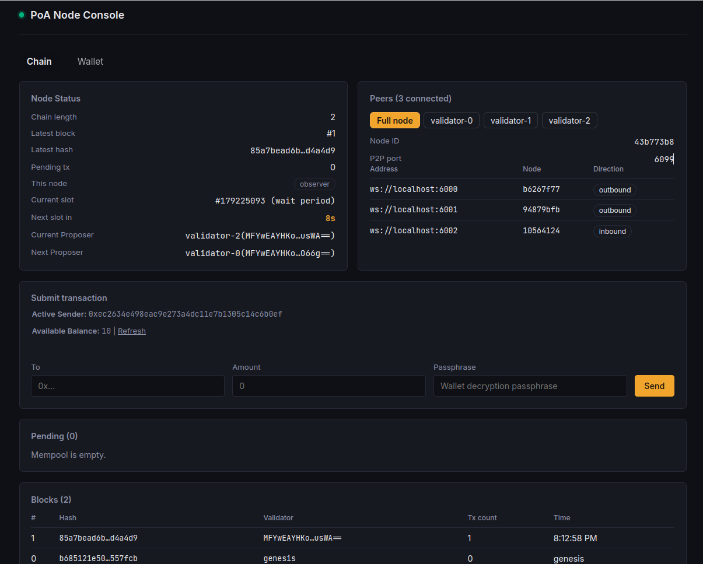

# PoA Blockchain (TypeScript)

A minimal **Proof-of-Authority blockchain** built from scratch in TypeScript, with a React console to watch and use it. It is an educational project: includes parts such as peer discovery, signed keystores, atomic state replay and a test suite for consensus and networking.



_The console: node status with the slot countdown, peers (switchable between the full node and each validator), transaction form, mempool and blocks._

**Frontend repo:** [muhumairkhan/react-blockchain-frontend](https://github.com/muhumairkhan/react-blockchain-frontend)

## Features

- **Time-slot PoA consensus:** the owner of each slot is `validators[slot % n]`, computed from the wall clock alone, so there is no leader election and no liveness tracking. A down validator's slot is simply skipped.
- **Account model:** balances and nonces, with signed transfers (ECDSA secp256k1). State is derived by replaying the chain from genesis, never stored.
- **Genesis commitment:** the genesis hash covers the starting balances and validator order, so nodes with different configs refuse each other.
- **P2P mesh over WebSockets:** bootnode discovery, peer exchange, a HELLO handshake that checks genesis and slot parameters, duplicate-connection resolution, heartbeats and reconnect backoff.
- **Longest valid chain wins:** a received chain is fully replayed before it replaces the local one.
- **Encrypted keystores:** AES-256-GCM with PBKDF2, in a format shared with the frontend wallet.
- **WebSocket API with live subscriptions** (`status`, `blocks`, `pending`, `peers`) used by the console.
- **Wallet library + CLI:** a `Wallet` class (locked/unlocked), a `WalletStore`, and a `NodeClient`, with a thin CLI on top.
- **Tests** for consensus rules, p2p behaviour and the wallet layer.

## Quick start

Requires Node.js 18+ (20+ recommended).

```bash
git clone https://github.com/muhumairkhan/proof-of-authority-blockchain
cd proof-of-authority-blockchain
npm install

# 1. Create 3 validators, a funded test wallet, and the genesis file
VALIDATOR_KEY_PASSPHRASE="correct horse battery staple" NUM_VALIDATORS=3 npm run reset

# 2. Start the validators (API :3000-3002, P2P :6000-6002)
VALIDATOR_KEY_PASSPHRASE="correct horse battery staple" npm start

# 3. In another terminal: start a full node (API :3099, P2P :6099)
npm run fullnode
```

Then start the frontend (it talks to the full node at `http://localhost:3099` by default):

```bash
git clone https://github.com/muhumairkhan/react-blockchain-frontend
cd react-blockchain-frontend
npm install
npm run dev
```

Send a transaction from the command line:

```bash
# `reset` created a wallet named "test" (passphrase "test") with 1000 coins
WALLET_PASSPHRASE=test npm run wallet -- create bob   # use any passphrase for bob
npm run wallet -- balance test
WALLET_PASSPHRASE=test npm run wallet -- send test bob 10
```

A block appears once the next slot's owner is out of its wait period (default: 15 s slots, 3 s wait). To use a wallet created in the browser, run `GENESIS_ADDRESS=0x... npm run reset` to fund it at genesis. To use the CLI's `test` wallet in the browser, import `wallets/test.json` on the Wallet page.

## Project layout

```
src/        core: blockchain, blocks, state, p2p, API, wallet layer
scripts/    generate-keys, reset, start, wallet CLI, and the test suites
docs/       architecture, protocol rules, roadmap
keys/       validator keystores (generated, do not commit)
data/       chain snapshots, peer tables, genesis.json (generated)
wallets/    CLI wallets (generated, do not commit)
```

## Commands

| Command                             | What it does                                                         |
| ----------------------------------- | -------------------------------------------------------------------- |
| `npm run reset`                     | Wipe `keys/ data/ wallets/` and regenerate everything                |
| `npm run generate-keys`             | Create validator keystores only                                      |
| `npm start`                         | Start all validators (`npm start -- reset` resets first)             |
| `npm run node1` / `node2` / `node3` | Start a single validator                                             |
| `npm run fullnode`                  | Start a non-validating full node                                     |
| `npm run wallet -- <cmd>`           | Wallet CLI: `create`, `import`, `list`, `address`, `balance`, `send` |
| `npm run test:chain`                | Consensus rules (offline)                                            |
| `npm run test:p2p`                  | PeerTable unit tests + real nodes over real sockets                  |
| `npm run test:wallet`               | Wallet, WalletStore and NodeClient                                   |
| `npm run build`                     | Compile with `tsc`                                                   |

Key environment variables are listed in [docs/ARCHITECTURE.md](docs/ARCHITECTURE.md#configuration). The most important ones: `VALIDATOR_KEY_PASSPHRASE`, `NUM_VALIDATORS`, `BLOCK_TIMEOUT_MS` and `SLOT_WAIT_MS` (the last two must be identical on every node), and `NODE_URL` for the CLI.

## Documentation

| Doc                                          | Contents                                                                                   |
| -------------------------------------------- | ------------------------------------------------------------------------------------------ |
| [docs/ARCHITECTURE.md](docs/ARCHITECTURE.md) | How the pieces fit together, file by file, plus configuration                              |
| [docs/PROTOCOL.md](docs/PROTOCOL.md)         | The exact rules every node and client must agree on: hashes, consensus, keystore, API, p2p |
| [docs/TODO.md](docs/TODO.md)                 | Roadmap and known gaps                                                                     |

## Limitations

This is a learning project, not a production system. Known gaps:

- **No replay protection:** a transaction's signature does not include a chain ID, so it could be replayed on another chain with the same account and nonce. Planned.
- **No finality or fork choice** beyond "longest valid chain".
- **Clock-dependent:** slot ownership depends on synchronised wall clocks (with a 2 s future-drift guard).
- **Whole-chain sync:** new peers and rejected blocks trigger full-chain transfers.
- **Unbounded mempool, no fees,** and a fixed validator set.
- **JSON snapshot storage** rewritten on every block.
- **Not audited.** Do not use real keys or value.

See [docs/TODO.md](docs/TODO.md) for the plan.

## Tech stack

Node.js, TypeScript, `ws`, `ts-node`, and Node's built-in `crypto` for core. React with `react-router` for the console.

## License

[MIT](LICENSE)
